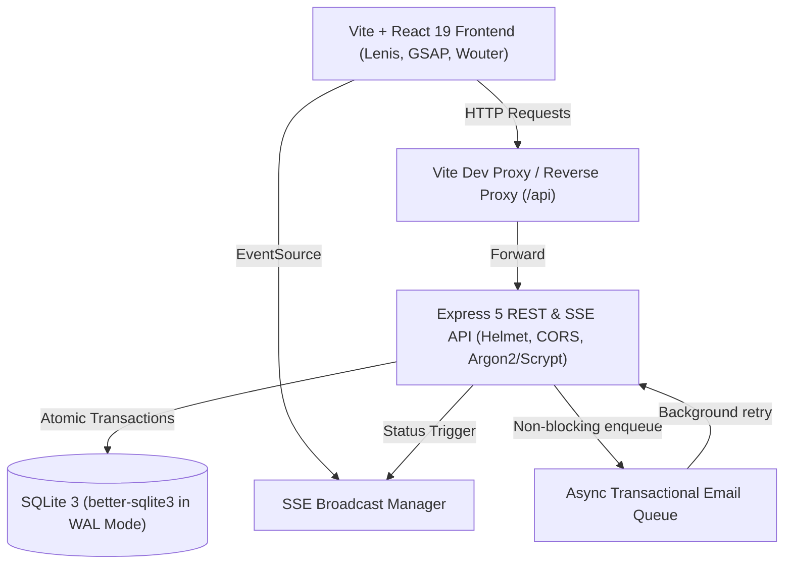

# AERO 34 — Long-Haul Private Seat & Charter Dispatch

AERO 34 is a private-seat allocation and charter dispatch platform operating on twelve verified long-haul global corridors. Visitors browse authentic route telemetry, verify monthly seat inventory, submit idempotent seat requests with atomic capacity decrement, and monitor dispatch status in real time via Server-Sent Events (SSE).

---

## Architecture Diagram



---

## Core Capabilities

1. **Corridor Explorer**: Browse 12 authentic city pairs (e.g. JFK–LHR, LHR–HND, HND–SFO) with verified block times, airframe specifications, and real-time monthly seat availability.
2. **Atomic Seat Reservation**: Idempotent request submissions (`idempotency_key`) prevent duplicate booking under network retries or rapid double-clicks. Seat inventory decrements atomically inside SQLite transactions.
3. **Persistent Shortlists**: Session-based shortlist persistence allowing visitors to bookmark routes across visits.
4. **Live Dispatch Tracking**: Unguessable cryptographically generated references (`AR-XXXXX`) connected to live Server-Sent Events push notifications (`/api/requests/:ref/stream`) with polling fallback.
5. **Operational Control Terminal**: Secure admin interface (`/admin`) protected by Scrypt password hashing, 5-failure 15-minute IP lockout, and instant status patching (`Received` → `Confirming` → `Held` → `Declined`).

---

## Visual & Motion System

- **Exact 3-Color Hierarchy**:
  - Ink `#0A0A09`
  - Bone `#EEEBE4`
  - Signal `#E8431A` (strictly reserved for focus, state changes, and primary action anchors)
- **Typography**: High-contrast display serif (`ZTChintzy` self-hosted with `display: swap`), clean grotesque sans (`Inter`), tabular numerals (`font-variant-numeric: tabular-nums`) across all flight data.
- **12-Column Grid**: 8px baseline, 24px desktop gutters, 1px hairlines at `rgba(10, 10, 9, 0.12)`, 0px or 2px corner radii. Zero glassmorphism, zero gradients, zero pill buttons.
- **Synchronized Motion**: Lenis smooth scrolling driven directly by the GSAP ticker. Three standardized CustomEases (`expo.out` 0.9–1.2s reveals, `power4.inOut` 0.6–0.8s shifts, `back.out(1.4)` settles). Automatic disabling on `prefers-reduced-motion` and touch viewports.

---

## Project Structure

```
├── .github/workflows/ci.yml       # GitHub Actions CI (audit, test, build)
├── server/
│   ├── src/
│   │   ├── db.ts                  # SQLite WAL initialization & migration runner
│   │   ├── auth.ts                # Scrypt hashing, random refs, session tokens, lockout
│   │   ├── email.ts               # Background transactional email queue with retry
│   │   ├── sse.ts                 # Server-Sent Events streaming manager
│   │   ├── seed.ts                # 12 real routes, 60-day availability, admin seed
│   │   ├── index.ts               # Express server, Helmet, rate limiting, error handler
│   │   ├── migrations/            # Numbered SQL migrations (001_initial_schema.sql)
│   │   └── routes/                # Modular Express routers (routes, requests, shortlist, admin)
├── shared/
│   └── schemas.ts                 # Shared Zod schemas (Route, Request, Status, Admin)
├── src/
│   ├── components/                # Cursor, Navigation, Footer
│   ├── lib/                       # API client (api.ts), Motion/Lenis setup (motion.ts)
│   ├── pages/                     # HomePage, RoutesPage, RouteDetailPage, CabinPage,
│   │                              # RequestPage, JournalPage, ArticlePage, AdminPage, LegalPages
│   ├── index.css                  # Master editorial design tokens & layout utilities
│   ├── App.tsx                    # Wouter router, page transition curtain, top progress bar
│   └── main.jsx                   # React 19 root bootstrap
├── tests/                         # Vitest API & integration test suite (api.test.ts)
└── scripts/                       # Database backup (backup.ts) and restore (restore.ts)
```

---

## Getting Started

### Prerequisites

- Node.js 20+ (Node v24 supported)
- npm 10+

### Installation & Environment Setup

```bash
git clone https://github.com/Jeeva1121/Aero34.git
cd Aero34
npm install
cp .env.example .env
```

### Running Locally

```bash
# 1. Run unit & API integration tests
npm test

# 2. Run API server (port 3001)
npm run server

# 3. In another terminal, run frontend dev server (port 5173)
npm run dev
```

Visit `http://localhost:5173` in your browser.

---

## API Reference

| Method | Endpoint | Description | Auth |
| :--- | :--- | :--- | :--- |
| `GET` | `/healthz` | Health check endpoint | Public |
| `GET` | `/api/routes` | Returns 12 authentic routes with seats remaining | Public |
| `GET` | `/api/routes/:slug` | Specific corridor specifications | Public |
| `GET` | `/api/routes/availability/lookup` | 60-day calendar availability | Public |
| `POST` | `/api/requests` | Submit seat request (atomic, idempotent) | Public |
| `GET` | `/api/requests/:ref/status` | Safe status lookup (rate-limited, no PII) | Public |
| `GET` | `/api/requests/:ref/stream` | Real-time SSE status push stream | Public |
| `GET` | `/api/shortlist` | Fetch session shortlisted route IDs | Session |
| `POST` | `/api/shortlist` | Add corridor to shortlist | Session |
| `DELETE` | `/api/shortlist/:routeId` | Remove corridor from shortlist | Session |
| `POST` | `/api/admin/login` | Dispatcher login (lockout on 5 failures) | Public |
| `POST` | `/api/admin/logout` | Terminate admin session | Admin |
| `GET` | `/api/admin/me` | Check session validity | Admin |
| `GET` | `/api/admin/requests` | List all requests with status filter | Admin |
| `PATCH` | `/api/admin/requests/:ref` | Update request status (triggers SSE & email) | Admin |

Default Admin Credentials (development seed):
- Username: `admin`
- Password: `aero34admin`

---

## Database Backup & Restore

```bash
# Run online atomic SQLite backup
npx tsx scripts/backup.ts

# Test database restore with pre-flight integrity verification
npx tsx scripts/restore.ts
```

---

## Known Limits

- SQLite is optimized for single-instance or primary/replica setups (e.g. LiteFS, Fly.io). For multi-region active-active clusters, deploy with Turso or PostgreSQL.
- Server-Sent Events require long-lived HTTP connections; ensure intermediate edge proxies (e.g. Cloudflare / Nginx) have buffering disabled (`X-Accel-Buffering: no`).
